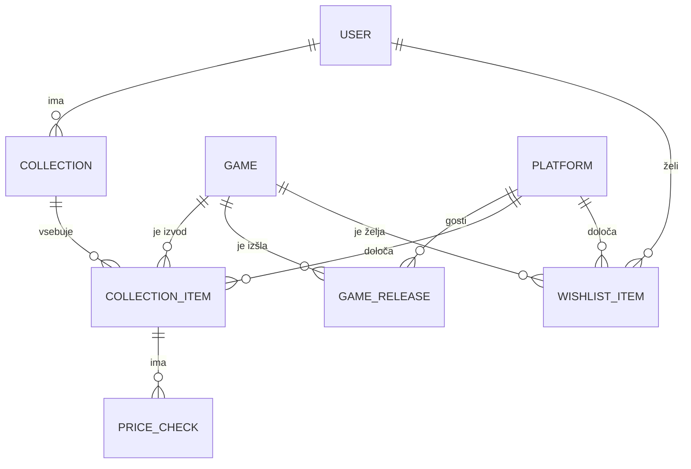

# 03 – Podatkovni model

Baza je relacijska (PostgreSQL) in hrani vnose uporabnikov ter toliko podatkov o igrah in platformah, da aplikacija deluje tudi takrat, ko IGDB ni dosegljiv. Entitete so Django modeli s primarnim ključem `id`.

## Entitete in glavna polja

| Entiteta | Glavna polja |
|---|---|
| **User** | `username`, `email`, `password` (zgoščeno), `role` (collector, moderator, admin), `is_active` |
| **Platform** – šifrant podprtih platform | `igdb_id` (unikaten), `name`, `abbreviation`, `manufacturer`, `generation`, `is_supported` |
| **Game** – predpomnjena igra iz IGDB | `igdb_id` (unikaten), `title`, `cover_url`, `release_year`, `genres`, `summary`, `synced_at` |
| **GameRelease** – izid igre na platformi | `game_id`, `platform_id`, `release_year` |
| **Collection** – poimenovana zbirka uporabnika | `user_id`, `name`, `description`, `is_public`, `is_hidden`, `hidden_by_id`, `hidden_at` |
| **CollectionItem** – izvod igre v zbirki | `collection_id`, `game_id`, `platform_id`, `region`, `condition`, `purchase_price`, `notes`, `estimated_price`, `price_checked_at`, `created_at` |
| **PriceCheck** – en pregled cene izvoda | `item_id`, `checked_at`, `price`, `currency`, `listing_count`, `source` |
| **WishlistItem** – igra, ki jo uporabnik še išče | `user_id`, `game_id`, `platform_id`, `region`, `condition`, `notes`, `created_at` |

## Enumeracije

| Polje | Vrednosti |
|---|---|
| `User.role` | `collector`, `moderator`, `admin` |
| `CollectionItem.region`, `WishlistItem.region` | `pal`, `ntsc_u`, `ntsc_j` |
| `CollectionItem.condition`, `WishlistItem.condition` | `loose` (samo nosilec), `cib` (komplet), `new` (zapakirano) |
| `PriceCheck.source` | `ebay` |

## Povezave

- **User 1 : N Collection** – uporabnik ima več zbirk.
- **User 1 : N WishlistItem** – uporabnik ima več želja.
- **Collection 1 : N CollectionItem** – zbirka vsebuje več izvodov.
- **Game 1 : N CollectionItem** – ista igra je lahko v več zbirkah in v več izvodih.
- **Game N : M Platform prek GameRelease** – igra je izšla na več platformah, na platformi je izšlo več iger.
- **Platform 1 : N CollectionItem** – izvod je vedno za natanko eno platformo.
- **Platform 1 : N WishlistItem** – želja je vedno za natanko eno platformo.
- **Game 1 : N WishlistItem** – isto igro si lahko želi več uporabnikov.
- **CollectionItem 1 : N PriceCheck** – izvod ima zgodovino pregledov cene.
- **User 1 : N Collection prek `hidden_by`** – moderator, ki je zbirko skril.

## Omejitve

| Omejitev | Zahteva |
|---|---|
| `Collection` unikaten `(user_id, name)` | Uporabnik ne more imeti dveh zbirk z istim imenom. |
| `GameRelease` unikaten `(game_id, platform_id)` | Izid igre na isti platformi se ne podvaja. |
| `WishlistItem` unikaten `(user_id, game_id, platform_id)` | Ista igra za isto platformo je na seznamu želja le enkrat. |
| `CollectionItem` brez unikatnosti | Isto igro je mogoče dodati večkrat, vsak zapis je svoj izvod. |
| `CollectionItem.region` in `condition` obvezna | Pri dodajanju izvoda sta zahtevana. |
| `WishlistItem.region` in `condition` neobvezna | Pri želji je obvezna samo platforma. |

## Opombe

- **Platforma je entiteta, ne niz.** Trije deli aplikacije potrebujejo platformo kot zapis v bazi: filter iskanja ponuja samo podprte platforme, obrazec za dodajanje ponuja samo platforme, na katerih je igra izšla, statistika pa šteje izvode po platformah. Uvoz CSV mora znati zavrniti neobstoječo platformo z razlogom.
- `Platform` se napolni iz IGDB kot fixture, ne ob dodajanju igre – filter platform mora obstajati, še preden je v bazi prva igra. `is_supported` je merodajno polje za obseg (fizične igre do vključno 7. generacije), `generation` pa služi prikazu in razvrščanju.
- `Platform` je šifrant platform, ne evidenca strojne opreme uporabnika; ta je v `02-funkcionalnosti-in-obseg.md` navedena kot kasnejša nadgradnja.
- **`GameRelease` nosi letnico izida na posamezni platformi,** ker se ta med platformami razlikuje. `Game.release_year` ostane prva izdaja igre.
- `Game` in `GameRelease` nastaneta, ko igro nekdo prvič poišče ali doda v zbirko. `Game` hrani naslov, naslovnico, leto, žanre in opis, da se iskanje in stran izvoda prikažeta tudi ob nedosegljivem IGDB; `synced_at` pove, kdaj so bili podatki osveženi. `genres` je polje nizov (PostgreSQL `ARRAY`), ker se po žanru ne išče in ne filtrira.
- **Regija je ločena od platforme.** Ista igra za PS2 je lahko PAL ali NTSC-U; regija vpliva na ceno in na statistiko, pri primerjavi zbirk pa se namenoma ne upošteva.
- **Zgodovina cen je svoja entiteta.** Vsak pregled se ohrani z datumom, ceno, številom oglasov in virom. `estimated_price` in `price_checked_at` na izvodu sta namenoma podvojena vrednost zadnjega pregleda: seznam zbirke in izračun vrednosti tako ne potrebujeta podpoizvedbe, pravilo o enem osveževanju na dan pa se preveri na samem izvodu.
- Sprememba platforme, regije ali stanja izvoda izbriše njegove `PriceCheck` zapise, ker se nanašajo na drugo izdajo.
- `PriceCheck.source` obstaja zato, ker je odjemalec za cene ločen modul in je vir mogoče zamenjati (glej `04-arhitektura-in-tehnoloski-sklad.md`). Cene so v EUR, `currency` je zapisana zaradi sledljivosti pregleda.
- **Seznam želja ni zbirka.** `WishlistItem` visi neposredno na uporabniku, zato seznam obstaja od registracije, ga ni mogoče izbrisati in se ne šteje v vrednost zbirk. Želja tudi ni izvod – uporabnik je igre še nima, zato sta regija in stanje neobvezna.
- Vloga je polje na uporabniku, ker ima vsak uporabnik natanko eno vlogo.
- `is_hidden` skrije javno zbirko, ne izbriše je. `hidden_by` in `hidden_at` zabeležita moderatorja in čas, ker lastnik vidi oznako »skrito«, zbirke pa ne more sam znova objaviti.

## Diagram podatkovnega modela

## Nadgradnja: forum

Forum doda tri entitete: `Channel` (kanal), `Post` (objava v kanalu) in `Comment` (komentar na objavo). Objave in komentarji se vežejo na `User` kot avtorja. Obstoječih tabel ne spreminja.
