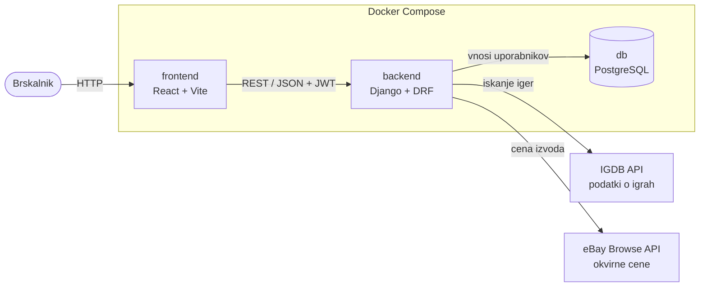

# 04 – Arhitektura in tehnološki sklad

## Arhitektura



### Glavni deli in komunikacija

- **Frontend** (React SPA) je uporabniški vmesnik brez poslovne logike. Z backendom komunicira prek REST API-ja (JSON, poti pod `/api/`).
- **Backend** (Django + DRF) vsebuje poslovno logiko in pravice po vlogah. Razdeljen je na aplikacije `users`, `collection`, `games` (odjemalec za IGDB) in `pricing` (odjemalec za eBay).
- **Zunanja API-ja** kliče samo backend. Ključa sta v okoljskih spremenljivkah.

### Podatkovna baza

PostgreSQL. Hrani uporabnike, zbirke, izvode in zgodovino njihovih pregledov cene, poleg tega šifrant podprtih platform in predpomnjene podatke o igrah iz IGDB. Do baze dostopa samo backend prek Django ORM, shemo upravljajo migracije.

### Avtentikacija in upravljanje uporabnikov

- Gesla zgoščuje Django s PBKDF2-SHA256 (SHA-256 s soljo in ponovitvami).
- Ob prijavi backend vrne žetona JWT: access (15 minut) in refresh (7 dni). Frontend pošilja access žeton v glavi `Authorization`.
- Vloga je polje `role` na uporabniku, pravice preverjajo razredi dovoljenj v DRF. Uporabnike upravlja administrator v Django adminu.

### Lokalni zagon

```bash
cp .env.example .env        # ključa za IGDB in eBay
docker compose up --build
docker compose exec backend python manage.py migrate
docker compose exec backend python manage.py loaddata platforms
```

Frontend teče na http://localhost:5173, API na http://localhost:8000/api/.

## Tehnološki sklad

| Področje | Tehnologije in orodja |
|---|---|
| Frontend | React, Vite, JavaScript, React Router, Axios, Tailwind CSS |
| Backend | Python, Django, Django REST Framework |
| Podatkovna baza | PostgreSQL |
| Avtentikacija | Django `auth`, `djangorestframework-simplejwt` |
| Lokalni razvoj | Docker, Docker Compose, `.env` |
| Drugo | IGDB API (podatki o igrah), eBay Browse API (okvirne cene), Git, pytest |

## Arhitekturne odločitve

| Odločitev | Utemeljitev |
|---|---|
| Ločena SPA in REST API | Jasna meja med vmesnikom in logiko. |
| Django + DRF | Uporabniki, dovoljenja, migracije in admin so že vgrajeni. |
| PostgreSQL | Podatki so relacijski (uporabnik, zbirka, izvod). Primerjava zbirk je kasneje operacija nad množicami v SQL, `pgvector` omogoča priporočila. |
| Podatki o igrah se berejo iz IGDB | Ni lastnega kataloga, ki bi ga bilo treba polniti in vzdrževati. V bazi ostane predpomnilnik tistega, kar aplikacija prikaže (naslov, naslovnica, leto, žanri, opis), in platform, na katerih je igra izšla, da iskanje in zbirke delujejo tudi ob nedosegljivem IGDB. |
| Platforme kot šifrant v bazi | Filter iskanja, obrazec za dodajanje izvoda in statistika po platformah potrebujejo stabilen seznam, ki obstaja še pred prvo igro. Napolni ga fixture z ID-ji iz IGDB. |
| Zunanja API-ja kliče backend, ne brskalnik | Ključa ostaneta skrita, omejitve klicev se nadzirajo na enem mestu. |
| JWT in PBKDF2-SHA256 | JWT ne potrebuje sej na strežniku. Goli SHA-256 je za gesla prehiter, PBKDF2 doda sol in ponovitve. |
| Docker Compose | Vse tri storitve z enim ukazom, enako okolje za vse. |
| Cene iz eBay Browse API, shranjene v bazi | Brezplačen (5.000 klicev na dan); PriceCharting je natančnejši, a plačljiv. Vsak pregled cene se ohrani kot zapis zgodovine, zadnja cena pa je podvojena na izvodu, da prikaz zbirke ne kliče API-ja in ne potrebuje podpoizvedbe. Odjemalec je ločen modul, da je vir mogoče zamenjati. |
| Forum kot nadgradnja | Doda le nove tabele, zato obstoječega modela ni treba spreminjati. |
